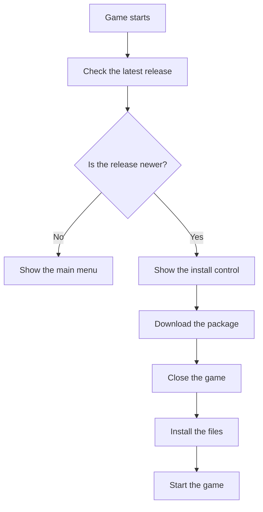

# Contribution rules

GunFare is a first-person shooter in Godot 4.7. The work on this game is not complete. These rules keep contributions clear and safe.

## Language

Write text for people in ASD-STE100 Simplified Technical English.
This rule applies to pull requests, issues, documents, and comments.
You can use the required syntax in code, in commands, and in file names.

Follow these limits:

- Use a maximum of 25 words in a descriptive sentence.
- Use a maximum of 20 words in a procedure sentence.
- Write one instruction in each procedure sentence.
- Do not use a contraction.
- Do not use a semicolon.
- Use the active voice.
- Use the same word for the same object.

## Pull requests

Do not push a commit directly to the main branch.
Open a pull request.
The pull request template is mandatory.
Continuous integration must pass before a merge.

The template has three evidence sections. Fill the sections that match your files. Write `Not applicable.` in each section that does not match.

| Files that you change | Required evidence |
| --- | --- |
| A screen, a scene, a shader, or a texture | A screenshot in the Screenshots section |
| An autoload, a match script, a map, a streak, or `project.godot` | A diagram in the Diagram section |
| A file in `scripts/data/` | A table in the Table section |

Use a Markdown image for a screenshot. Use a `mermaid` block or an image for a diagram.

## Updates in the game

A release build checks the latest GitHub release at startup.
If the release version is newer, the main menu shows an install control.
The player starts the install from that control.
The game downloads the package for the player operating system.
The game starts an install script and then closes.
The script waits until the game process stops.
The script copies the new files over the install directory.
The script starts the game again.

The package names are:

| Operating system | Package | Program file |
| --- | --- | --- |
| Windows | `GunFare-windows.zip` | `GunFare.exe` |
| Linux | `GunFare-linux.zip` | `GunFare.x86_64` |
| macOS | `GunFare-macos.zip` | `GunFare.app` |

A source build uses the Godot program. Do not install a package over that program.

## Release steps

1. Set `application/config/version` in `project.godot` to the new number.
2. Open a pull request and merge it.
3. Create a tag `v` plus that same number.
4. Wait until the Release workflow publishes the packages.

## Local test commands

Run the progression test:

`godot --headless --path . res://tests/test_progression.tscn`

Run the match test:

`godot --headless --path . res://tests/smoke_match.tscn -- dustline tdm 20`

Run the text check:

`python tools/check_pr.py --self-test`
